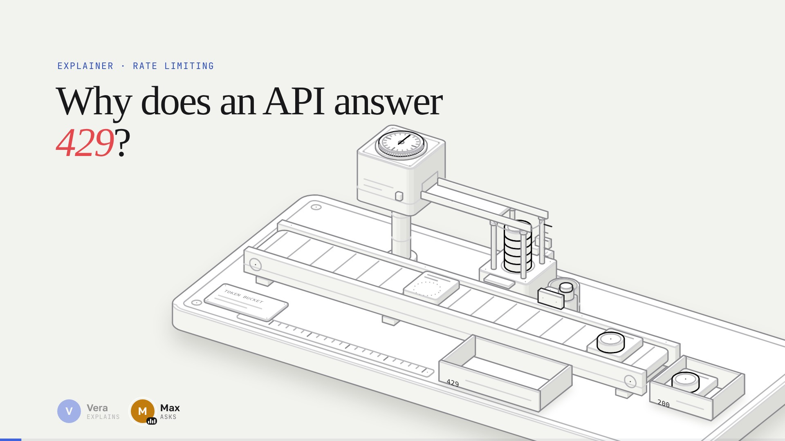

# Explainer

**English** · [Русский](README.ru.md)

**Demo: [explainer.nemilya.me](https://explainer.nemilya.me/)** — the catalog, the token bucket topic: [English](https://explainer.nemilya.me/explainers/token-bucket/) · [Русский](https://explainer.nemilya.me/explainers/token-bucket/ru/)

"How does it work" explainers, built in three forms from one model:

- **an interactive illustration** — an isometric machine made with [anatomy](https://github.com/wheresryan22/anatomy)
  (a copy lives in [`anatomy/`](anatomy/)), whose working *is* the idea;
- **a narrated video** — the camera moves onto parts of the running machine while the hosts explain it (one
  narrator or a "one asks, one explains" dialogue), in 16:9 and 9:16 with burned-in captions, in several
  languages — the [video-kit](video-kit/) engine;
- **a landing page** — the questions, the live machine with controls and counters, the video with chapters,
  the gist and the code.

**Example:** [`explainers/token-bucket`](explainers/token-bucket) — "Why does an API answer 429?": a token bucket
as a machine (a coin magazine is the bucket, a hopper clock is the refill, a request belt, trays for 200 and 429),
a ~2.5-minute dialogue between Vera and Max (English and Russian, horizontal and vertical), and a landing page
with the live model.



## Layout

```
anatomy/            isometric figure skill and kit — a copy of wheresryan22/anatomy @ 240a9bf (MIT), kept unmodified
video-kit/          video engine (from nemilya/infographics) + the figure layer: lib/figure.js (camera, pins),
                    film.layers and film.speakers in stage/stage.js; topic template — template-explainer/
explainers/
  build.mjs         site builder: template + i18n/<lang>.mjs → static HTML per language + assets → dist/ (make dist)
  lang.js           language auto-pick before first paint; suggest.js, video.js, landing.css — shared
  catalog/          catalog template and i18n
  <topic>/
    QUESTIONS.md    brief: questions, the truth (numbers), the object, parts, scenes
    model.js        the model — the single source of every number, pure functions of time
    figure.js       anatomy figure: buildFigure() → SVG and anchors, mountFigure() → apply(state)
    landing/        page template index.html + i18n/en.mjs, ru.mjs; landing.js — the live figure
    video/          film.js, text/<lang>.js, scenes.css, voice.config.json, SCENARIO.md, voice/, out/, out/web/
dist/               the built site — copy it to the hosting (make dist; not in git)
site.mjs            site address and languages (first one is the main language)
Makefile            make help · serve · landing · test · new
.claude/skills/     explain — how to build a topic; anatomy — link to the figure skill
```

The key idea is **one model for everything**: `model.js` plays the events, `figure.js` places the parts from the
state, the video draws each frame as a function of time (frame-by-frame rendering, instant seeking), and the
landing page runs the same model live. The machine's schedule in the video is built from the lines: an event
happens exactly on the word that names it, and after a new voice-over everything lands in place again.

## Languages

English is the main language; every other language lives in a subfolder with its own URL (as in
nemilya/scantunnel): `/` and `/ru/`, `/explainers/token-bucket/` and `/explainers/token-bucket/ru/`. Pages are
built from one template and per-language dictionaries (`make dist`): each has `<html lang>`, its own
title/description, `canonical`, `hreflang` for every language plus `x-default` → English, and a shared
`sitemap.xml`. Dictionaries must have identical keys — the build fails otherwise.

**Which language a visitor sees** (`explainers/lang.js`, a blocking script in `<head>`, before first paint):

1. an explicit choice — `explainer-lang` in `localStorage` (a click on EN/RU, "Open" or × on the banner);
2. the browser's main language, if it is not the main site language (`ru-RU` → ru);
3. the country by time zone: Russia, Belarus, Kazakhstan → ru (no GeoIP, the site stays static);
4. otherwise English.

Only the main page redirects (`location.replace`), and only a person arriving from outside: bots and links
inside the site stay, so English is indexed. A direct link to `/ru/` never redirects; if the visitor's pick
differs, the page shows a banner "This page is available in English → Open". The auto-pick is not saved —
only an explicit choice is.

Videos follow the same order: English is the main language (`TEXTS = { en, ru }` in `film.js`), files are
`out/<name>.mp4` (en) and `out/<name>-ru.mp4`. The landing plays light versions from `out/web/` (`make web`);
on a phone in portrait, if a vertical cut exists, it opens 9:16 first.

A new language: a line in `site.mjs`, `i18n/<code>.mjs` for the catalog and each topic, `text/<code>.js` and
`langs.<code>` in `voice.config.json` for the video, countries in `TZ` in `explainers/lang.js`, then
`make dist test`.

## Commands

```bash
make help        # all commands
make dist        # build the site into dist/ — the folder to copy to the hosting
make preview     # build and open dist/: http://127.0.0.1:8791/ (/ru/ — Russian)
make deploy DEPLOY=user@host:/var/www/explainer/   # build and rsync dist/ to the server
make test        # language auto-pick, dictionaries, no broken links in the built site
make serve       # dev server over the repository (video players): http://127.0.0.1:8790/
make new SLUG=my-topic TITLE="How … works"
```

In a video folder (`explainers/<topic>/video`, `make help` there too): `make preview`, `make voice [LNG=ru]`,
`make video video-cc [LNG=ru]`, `make web` (720p versions for the site, ~3× smaller), `make cover`.

**Rendering without overheating a laptop:** on macOS the encoder defaults to hardware VideoToolbox (the CPU
stays almost free; `ENC=sw` for x264), `ENC=hw` uses NVENC on Linux/Windows, `THREADS=2` limits x264 to two
threads, `PAUSE=40` adds a pause between frames (ms), and ffmpeg and Chromium run at lower priority (`NICE=10`
by default). `make web` compresses with x264 at lower priority (`THREADS=2` and `ENC=hw` work there too).

## A new topic

In Claude Code: `/explain how … works` (the [`.claude/skills/explain`](.claude/skills/explain/SKILL.md) skill).
By hand:

```bash
make new SLUG=my-topic TITLE="How … works"   # stubs for every part
cd explainers/my-topic/video
make preview                       # video player: http://127.0.0.1:8790/explainers/my-topic/video/
make voice && make voice LNG=ru    # voice-over (OPENROUTER_API_KEY)
make video video-cc                # MP4 16:9 and 9:16 with captions → out/
make video video-cc LNG=ru
make web                           # light versions for the site → out/web/
make cover && make cover LNG=ru    # Reels covers
cd ../../.. && make preview        # rebuild the site and look at it
```

## Publishing

The site is static and lives entirely in `dist/` after `make dist`: copy the folder's contents to any static
hosting as is (or `make deploy` with `DEPLOY=user@host:/path/` — rsync; the address can also go into `local.mk`).
The site address is in `site.mjs` (now the demo, https://explainer.nemilya.me/): canonical, hreflang and sitemap.xml
are built from it, so change it when publishing elsewhere. `repo` there is the source link shown on every page.

`dist/` keeps the repository layout and holds only what the browser needs: the pages (`index.html`, `ru/`,
`explainers/<topic>/`, `…/ru/`, `sitemap.xml`, `robots.txt`), shared scripts and styles, fonts, the anatomy kit,
every topic's figure/model/landing script, light videos (`video/out/web/`), subtitles and the live video player
with its voice-over. For token-bucket that is about 29 MB, mostly the four videos. The folder is not committed;
`make dist` recreates it from scratch, and `make test` checks that nothing in it links to a missing file.

## anatomy: keeping the copy up to date

[`anatomy/`](anatomy/) is a vendored copy of [wheresryan22/anatomy](https://github.com/wheresryan22/anatomy) at
commit **`240a9bf`**, unmodified (our changes go only to `video-kit/` and `explainers/`). To update it from upstream:

```bash
git clone https://github.com/wheresryan22/anatomy /tmp/anatomy
git -C /tmp/anatomy log --oneline 240a9bf..HEAD                    # what changed since our copy
git -C /tmp/anatomy diff --stat 240a9bf..HEAD -- kit SKILL.md references
rsync -a --delete --exclude .git /tmp/anatomy/ anatomy/              # take the new version
```

Afterwards check that the figures still build (`explainers/*/figure.js` import `anatomy/kit/iso-kit.mjs`), look at
stills (`make stills`), and record the new commit here, in `README.ru.md` and in `CLAUDE.md`.

## Requirements

Node 22 and `ffmpeg`; for rendering — Playwright (`make install` in a video folder) and Chromium. An OpenRouter
key is needed only for the voice-over: `export OPENROUTER_API_KEY=…` or `OPENROUTER_API_KEY = …` in the video's
`local.mk` (not in git).

## Licenses

`anatomy/` — MIT (© wheresryan22, see [`anatomy/LICENSE`](anatomy/LICENSE)). Fonts in `video-kit/fonts/` — OFL.
