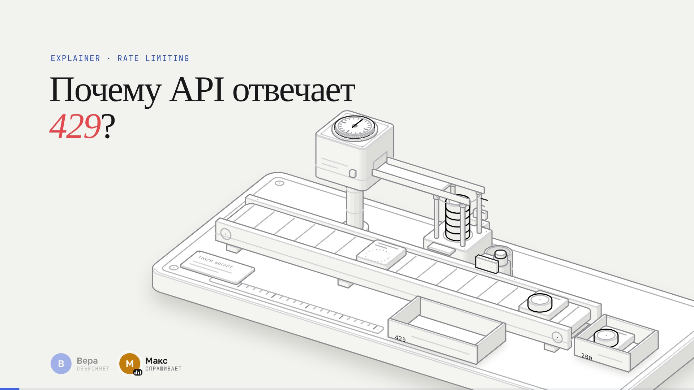

# Explainer

[English](README.md) · **Русский**

**Демо: [explainer.nemilya.me/ru/](https://explainer.nemilya.me/ru/)** — каталог; пример темы: [Почему API отвечает 429?](https://explainer.nemilya.me/explainers/token-bucket/ru/)

Объяснения «как это работает» в трёх видах из одной модели:

- **интерактивная иллюстрация** — изометрическая машина на ките [anatomy](https://github.com/wheresryan22/anatomy) (копия в [`anatomy/`](anatomy/)),
  чьё устройство *и есть* идея;
- **ролик с озвучкой** — камера наезжает на детали машины, а ведущие объясняют (один голос или диалог
  «спрашивает — объясняет»), 16:9 и 9:16 с субтитрами в кадре, на нескольких языках — движок [video-kit](video-kit/);
- **лендинг** — вопросы, живая машина с кнопками и счётчиками, ролик с главами, суть и код.

**Пример:** [`explainers/token-bucket`](explainers/token-bucket) — «Почему API отвечает 429?»: token bucket
в железе (магазин монет — ведро, часы бункера — пополнение, лента запросов, лотки 200 и 429), ролик-диалог
Веры и Макса на ~2,5 минуты (ru и en, горизонтальный и вертикальный), лендинг с живой моделью.



## Как устроено

```
anatomy/            скилл и кит изометрических фигур — копия wheresryan22/anatomy @ 240a9bf (MIT), не правим
video-kit/          движок роликов со слоем фигуры: lib/figure.js (камера, булавки),
                    film.layers и film.speakers в stage/stage.js; шаблон темы — template-explainer/
explainers/
  build.mjs         сборка сайта: шаблон + i18n/<язык>.mjs → статические HTML на каждый язык + файлы → dist/ (make dist)
  lang.js           автовыбор языка до отрисовки; suggest.js, video.js, landing.css — общее
  catalog/          шаблон и словари каталога
  <тема>/
    QUESTIONS.md    бриф: вопросы, правда (числа), объект, детали, сцены (QUESTIONS.ru.md — перевод)
    model.js        модель — единственный источник чисел, чистые функции времени
    figure.js       фигура anatomy: buildFigure() → SVG и якоря, mountFigure() → apply(состояние)
    landing/        шаблон страницы index.html + i18n/en.mjs, ru.mjs; landing.js — живая фигура
    video/          film.js, text/<язык>.js, scenes.css, voice.config.json, SCENARIO.md (+ .ru.md), voice/, out/, out/web/
dist/               собранный сайт — его копируют на хостинг (make dist; не в git)
site.mjs            адрес сайта и языки (первый — основной)
Makefile            make help · serve · landing · test · new
.claude/skills/     explain — порядок работы над темой; anatomy — ссылка на скилл фигур
```

Ключевая идея — **одна модель на всё**: `model.js` проигрывает события, `figure.js` ставит детали по
состоянию, ролик рисует кадр как функцию времени (покадровый рендер, мгновенная перемотка), лендинг крутит
ту же модель вживую. Расписание машины в ролике строится от реплик: событие случается ровно на слове, которым
о нём говорят, и после новой озвучки всё встаёт на место само.

## Языки

Основной язык — английский, остальные — в подпапке со своим адресом: `/` и `/ru/`,
`/explainers/token-bucket/` и `/explainers/token-bucket/ru/`. Страницы собираются из одного шаблона и словарей
по языкам (`make dist`): у каждой `<html lang>`, свои title/description, `canonical`, `hreflang` на все
языки и `x-default` → английский, общий `sitemap.xml`. Ключи словарей обязаны совпадать — иначе сборка падает.

**Какой язык увидит читатель** (`explainers/lang.js`, блокирующий скрипт в `<head>`, до первой отрисовки):

1. явный выбор — `explainer-lang` в `localStorage` (клик по EN/RU, «Открыть» или × в плашке);
2. основной язык браузера, если он не основной язык сайта (`ru-RU` → ru);
3. страна по часовому поясу: Россия, Беларусь, Казахстан → ru (без GeoIP — сайт остаётся статикой);
4. иначе — английский.

Уводим (`location.replace`) только с основной страницы и только человека, пришедшего снаружи: боты и переходы
внутри сайта остаются — английский индексируется. С `/ru/` по прямой ссылке не уводим никогда; если выбор
другой — плашка «This page is available in English → Open». Автовыбор не запоминается, только явный выбор.

Ролики — в том же порядке: основной английский (`TEXTS = { en, ru }` в `film.js`), файлы `out/<имя>.mp4` (en)
и `out/<имя>-ru.mp4`. Лендинг показывает лёгкие версии из `out/web/` (`make web`); на телефоне в портретной
ориентации, если есть вертикальный ролик, сразу 9:16.

Новый язык: строка в `site.mjs`, `i18n/<код>.mjs` у каталога и каждой темы, `text/<код>.js` и `langs.<код>`
в `voice.config.json` ролика, страны в `TZ` в `explainers/lang.js` → `make dist test`.

## Команды

```bash
make help        # все команды
make dist        # собрать сайт в dist/ — эту папку копируют на хостинг
make preview     # собрать и открыть dist/: http://127.0.0.1:8791/ (/ru/ — русский)
make deploy DEPLOY=user@host:/var/www/explainer/   # собрать и залить dist/ на сервер через rsync
make test        # автовыбор языка, словари, в собранном сайте нет битых ссылок
make serve       # сервер разработки поверх репозитория (плееры роликов): http://127.0.0.1:8790/
make new SLUG=my-topic TITLE="How … works"
```

В папке ролика (`explainers/<тема>/video`, там тоже `make help`): `make preview`, `make voice [LNG=ru]`,
`make video video-cc [LNG=ru]`, `make web` (720p-версии для сайта, примерно в 3 раза меньше), `make cover`.

**Рендер без перегрева ноутбука:** на macOS по умолчанию аппаратный кодек VideoToolbox (процессор почти свободен;
`ENC=sw` — x264), `ENC=hw` — NVENC на Linux/Windows, `THREADS=2` — x264 не больше двух потоков, `PAUSE=40` —
пауза между кадрами (мс), ffmpeg и Chromium работают с пониженным приоритетом (`NICE=10` по умолчанию).
`make web` сжимает x264 с пониженным приоритетом (`THREADS=2` и `ENC=hw` там тоже работают).

## Новая тема

В Claude Code: `/explain как работает …` (скилл [`.claude/skills/explain`](.claude/skills/explain/SKILL.md)).
Вручную:

```bash
make new SLUG=my-topic TITLE="How … works"   # заготовка всех частей
cd explainers/my-topic/video
make preview                       # плеер ролика: http://127.0.0.1:8790/explainers/my-topic/video/
make voice && make voice LNG=ru    # озвучка (OPENROUTER_API_KEY)
make video video-cc                # MP4 16:9 и 9:16 с субтитрами → out/
make video video-cc LNG=ru
make web                           # лёгкие версии для сайта → out/web/
make cover && make cover LNG=ru    # обложки Reels
cd ../../.. && make preview        # пересобрать сайт и посмотреть
```

## Выкладка

Сайт статический и после `make dist` целиком лежит в `dist/`: содержимое папки копируется на любой статический
хостинг как есть (или `make deploy` с `DEPLOY=user@host:/path/` — rsync; адрес можно записать и в `local.mk`).
Адрес сайта — в `site.mjs` (сейчас демо, https://explainer.nemilya.me/): от него строятся canonical, hreflang и
sitemap.xml, поэтому при выкладке в другое место его нужно поменять. `repo` там же — ссылка на исходники на каждой странице.

`dist/` повторяет структуру репозитория и содержит только то, что нужно браузеру: страницы (`index.html`, `ru/`,
`explainers/<тема>/`, `…/ru/`, `sitemap.xml`, `robots.txt`), общие скрипты и стили, шрифты, кит anatomy, фигуру,
модель и скрипт лендинга каждой темы, лёгкие ролики (`video/out/web/`), субтитры и живой плеер ролика с озвучкой.
У token-bucket это около 29 МБ, в основном четыре ролика. Папка не коммитится: `make dist` пересоздаёт её с нуля,
а `make test` проверяет, что в ней нет ссылок на отсутствующие файлы.

## anatomy: сопровождение

`anatomy/` — копия [wheresryan22/anatomy](https://github.com/wheresryan22/anatomy) на коммите **`240a9bf`**, без
изменений (наши правки — только в `video-kit/` и `explainers/`). Обновить из мастер-репозитория:

```bash
git clone https://github.com/wheresryan22/anatomy /tmp/anatomy
git -C /tmp/anatomy log --oneline 240a9bf..HEAD             # что изменилось с нашей версии
git -C /tmp/anatomy diff --stat 240a9bf..HEAD -- kit SKILL.md references
rsync -a --delete --exclude .git /tmp/anatomy/ anatomy/       # взять новую версию
```

После обновления — проверить, что фигуры собираются (`explainers/*/figure.js` импортируют
`anatomy/kit/iso-kit.mjs`), посмотреть кадры (`make stills`), и записать новый коммит здесь и в `CLAUDE.md`.

## Требования

Node 22, `ffmpeg`; для рендера — Playwright (`make install` в папке ролика) и Chromium. Ключ OpenRouter нужен
только для озвучки: `export OPENROUTER_API_KEY=…` или `OPENROUTER_API_KEY = …` в `local.mk` ролика (не в git).

## Лицензии

Этот репозиторий — MIT, см. [`LICENSE`](LICENSE). `anatomy/` — MIT (© wheresryan22, см. `anatomy/LICENSE`). Шрифты в `video-kit/fonts/` — OFL.
